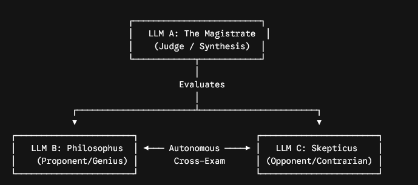

# Large Language Models - Conversing through Debates

## Abstract

Multi-Agent Debate (MAD) was formally introduced in peer-reviewed research (arXiv:2305.14325) by Yilun Du et al. as a framework to reduce hallucinations and overcome Degeneration-of-Thought in Large Language Models (LLMs). While conventional MAD setups rely on direct iterative counter-arguments, they often suffer from topic drift, sycophantic convergence, or superficial disagreements. To address these limitations, this paper introduces the "Roman Forum" architecture. 3 agent dialectic system that incorporates autonomous, self-directed cross-examination. In this model, an affirmative agent ("Philosophus") and an adversarial agent ("Skepticus") do not merely respond to statements, but autonomously generate probing sub-questions to interrogate core premises and surface hidden failure modes. A neutral magistrate agent ("Praetor") enforces procedural constraints, evaluates logical fallacies, and synthesizes the final decree.

## Scope

This is a small, independent pilot of one algorithm: a three-agent debate in the *Roman Forum* style. A **Philosopher** lays out an answer, a **Skeptic** questions it for several rounds, and a **Judge** closes the debate with a final answer. The debate system consists of a mixed-model setup. The study measures the quality of the text produced, the cost to produce it compared to a single-model setup and the prevention of degeneration of text in hard problems. 20 Math questions were supplied for this scope.

### Participants

* Claude = claude-sonnet-4-6
* GPT = gpt-4o

## Hypothesis

H1 – Accuracy. The Forum answers at least as many questions correctly as the better of Claude alone and GPT alone.
H2 – Cost. The Forum uses more tokens, calls and time than a single call. The study reports the size of the difference and does not assume a saving.
H3 – Efficiency. Tokens per correct answer is the deciding number: the Forum is worth its cost only if its accuracy gain is not outweighed by its extra tokens.
H4 – Error correction. Comparing the Philosopher's opening answer with the Judge's final answer shows whether the debate fixes wrong openings more often than it ruins right ones.
H5 – Convergence. When the Skeptic agrees (AGREEMENT: YES), the final answer is usually correct. If agreeing debates are no more accurate than non-agreeing ones, agreement signals caving and not convergence.
H6 – Resistance to a wrong position. When the Philosopher is assigned a wrong answer to defend, the Skeptic and Judge still reach the correct final answer in most runs.

## Conditions

All runs are bound by the same token limit.

C1 – Claude alone. One call, prompted to reason step by step and end with ANSWER: <number>.
C2 – GPT alone. The same prompt, sent to GPT.
C3 – Forum.
* Philosopher (Claude) lays out an answer and defends it. It must answer each of the Skeptic's questions directly and concede genuine errors. Every message ends with ANSWER: <number>.
* Skeptic (GPT) re-derives the key steps, asks 1 to 3 pointed questions about the premises and steps, and starts every reply with AGREEMENT: YES or AGREEMENT: NO.
* Judge (Claude) reads the exchange once, checks whether each of the Skeptic's questions was answered, notes flawed reasoning, verifies the math if there is doubt, and ends with FINAL ANSWER: <number>.
S – Stress test. The Forum on the first 10 questions, except that the Philosopher is secretly assigned a plausible wrong answer to defend. The Skeptic and Judge receive no hint.

## Methodology/Procedure

1. Run */exp/compare.py* and confirm answers are verified.
2. Each questions runs once through C1, C2 and C3. First 10 questions are run through S.
3. Every messages is logged to JSON.
4. Script prints summary, saved to results.json. Debate transcripts are saved to *compare_* folder respective of the run.

## Results

| System | Correct | Avg tokens | Avg calls | Avg seconds | Tokens per correct |
|---|---|---|---|---|---|
| Claude | 20/20 | 519 | 1.0 | 6.5 | 519 |
| GPT | 16/20 | 583 | 1.0 | 6.2 | 729 |
| Forum | 20/20 | 3,960 | 3.95 | 22.3 | 3,960 |

The forum approach used roughly x7.6 times more tokens than Claude by itself.

**Hypotheses.**

| | Outcome |
|---|---|
| H1 | The Forum tied the better solo model (20/20 each) and beat GPT alone (20 vs. 16). It showed no advantage over Claude alone, which was already at the ceiling. |
| H2 | Supported. 7.6 times the tokens, 3.95 calls against 1, and about 3.5 times the time. |
| H3 | The Forum cost 3,960 tokens per correct answer against 519 for Claude alone, so it was not worth its cost on this set. |
| H4 | Not supported, with no room to show it: there were no wrong openings to fix and none ruined. |
| H5 | Not assessable: one Skeptic message per debate. |
| H6 | Supported narrowly: 10/10 correct. The Judge is Claude, which solves all 20 questions alone, so the result cannot be attributed to the Skeptic or the debate, and only 8 runs actually opened with the wrong answer. |

## Conclusion

On all 20 math questions, the Forum approach has not performed better than a single strong model, like Claude. It cost x7.6 more to solve. If ran against cheaper or weaker models, it might have performed better while still sacrificing token usage.

## Limitations

* Twenty questions means a difference of one or two questions is within noise.
* Claude alone scored 20/20, so there was no headroom for the debate to show a benefit.
* Claude, one of the tested models, also wrote the questions, which may favor it. The answer key itself does not depend on Claude, because every answer is recomputed in code.
* The Judge is Claude and may favor Claude's reasoning. The Judge can also solve the problem itself, so some of any gain may come from the Judge and not the debate.
* The debate ran about one and a half rounds, not the designed two to three, so the results describe a shorter debate than the one specified.
* Two GPT results have no parsed answer, which may understate GPT alone and overstate the Forum's rescues against it.
* The Forum makes about 4 calls against 1 for a solo model, so any accuracy gain may reflect extra compute and not the debate structure. A majority vote over repeated solo calls would test this and is not included.
* The Skeptic is prompted to look for errors, which could push it to object to a correct answer.
* The stress test depends on the Philosopher following the instruction to defend a wrong answer, and in 2 of 10 runs it did not.
* Each question runs once, and model output varies between runs.